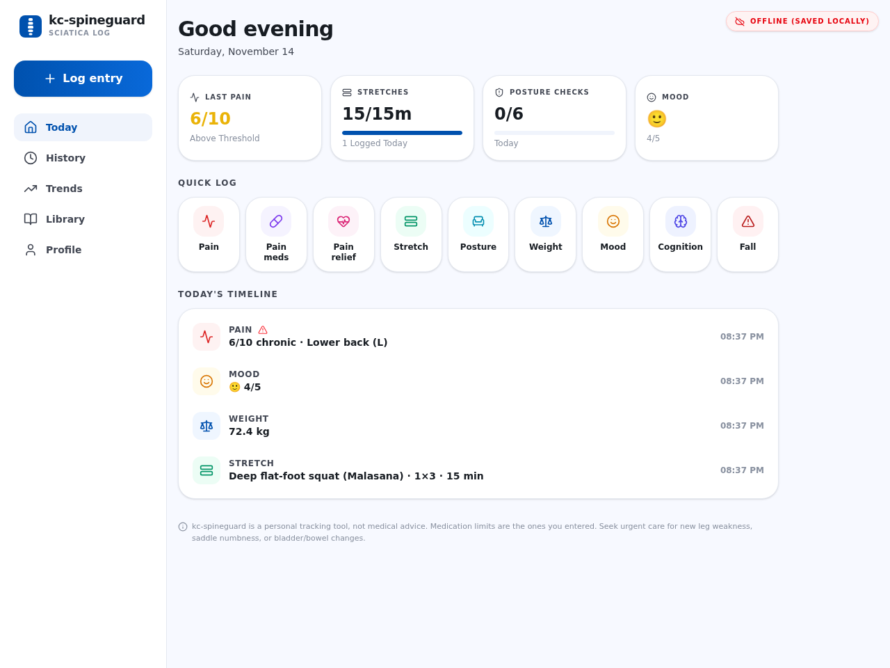
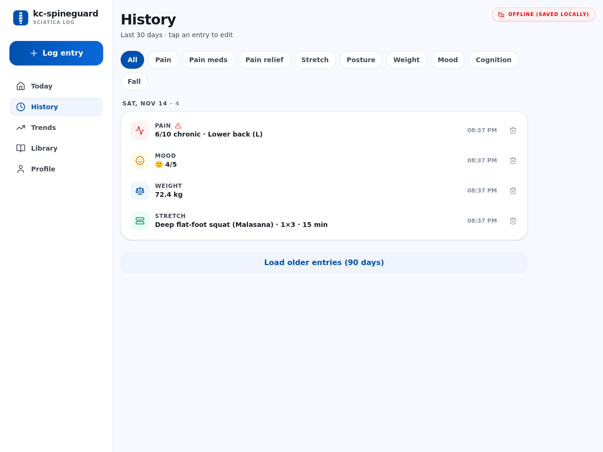
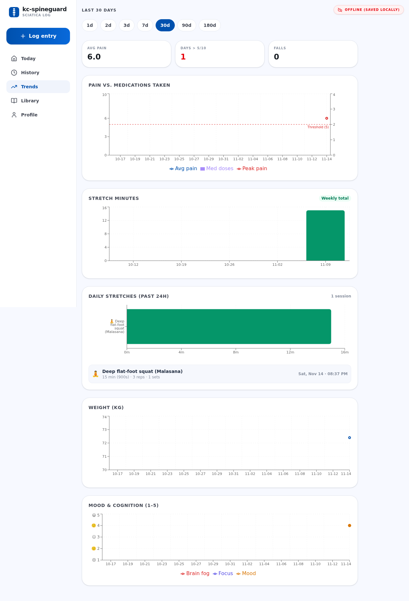
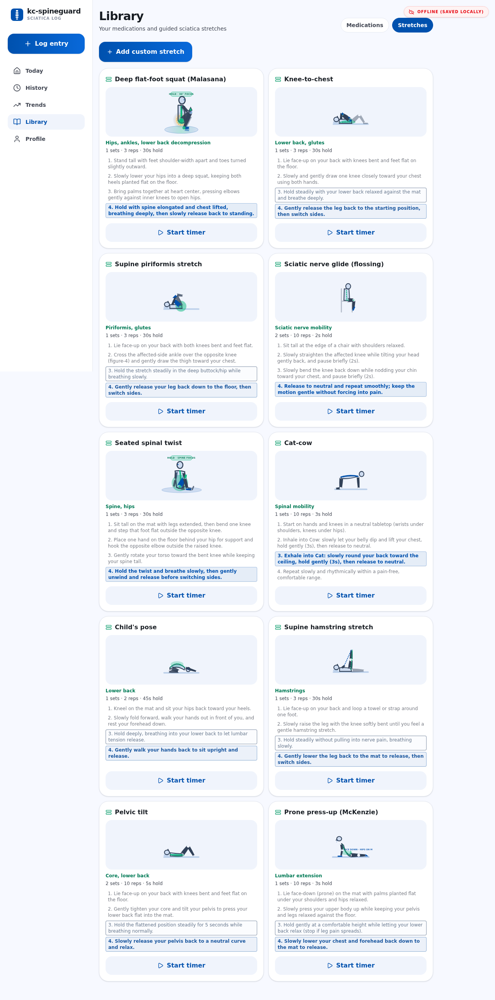
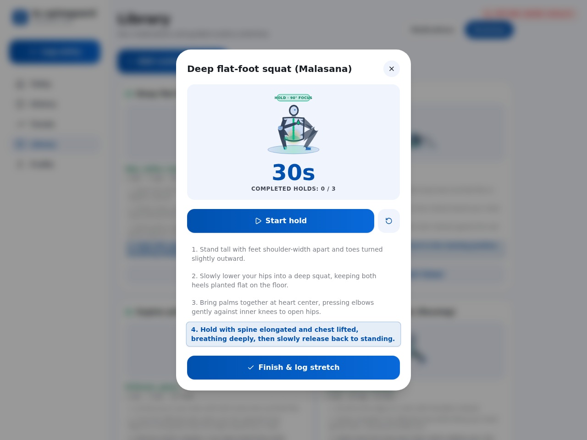
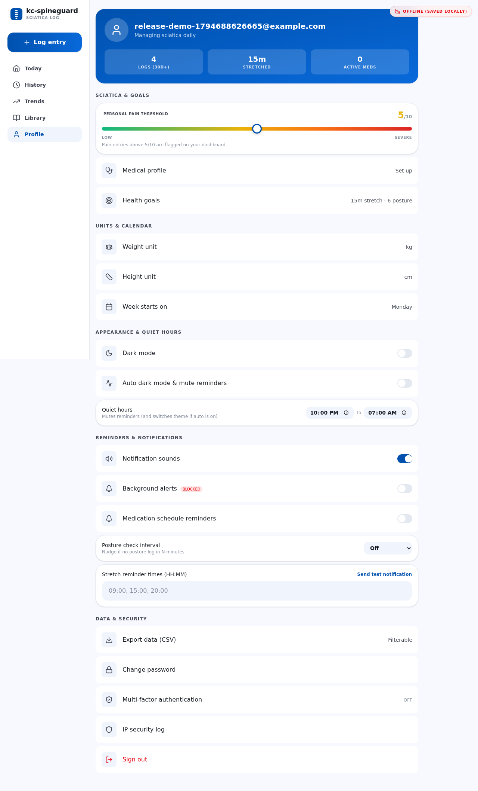

# Release Notes — v1.1.0

**Release Tag:** `v1.1.0`  
**Release Date:** 2026-11-14  
**Commit Range:** [`v1.0.0...v1.1.0`](https://github.com/genidma/kc-spineguard/compare/v1.0.0...v1.1.0)  
**Production URL:** [https://kc-spineguard.web.app](https://kc-spineguard.web.app)  

---

## 📜 Full Changelog (Changes Since Previous `v1.0.0`)

```text
2bce667 feat(history): add direct log deletion with confirmation modal
3cecd61 fix(trends): add intraday weight timeline & cap stretch minutes at 240
1d264fa docs: add Issue #10 to v1.1.0 draft release notes
0bad278 feat(stretches): make stretch minutes mandatory (0.5 - 999) and add past 24h visual breakdown graph (#10)
c1338b3 docs: advance primary target to Issue #7 (Cognition Redesign) in forward_tasks.md
2407fe0 feat(trends): adaptive stretch minutes grouping and Daily Stretches card with tiny stretch emojis (#10)
6a76bc7 docs: track Issue #10 (Trends: Stretch) in forward_tasks.md
000bbf3 feat(stretches): weave Stretch->Hold->Release into all 10 stretches, fix Malasana pelvis/camera double-take, redesign Seated Twist & add Prone landmarks (#8, #6)
fee91c8 feat(stretches): sequence motion first then slow 90-deg camera orbit/tilt for Malasana & Seated Twist; update forward_tasks (#8, #6)
b985787 feat(stretches): slow calculus-curve 3D camera orbit (0->-12->90 deg) with stretch-zone zoom & deep hip joint articulation (#8, #6)
c35a9e9 docs: credit Argon (High) alongside gemini-3.8-flash-low in v1.1.0 draft release and forward_tasks
8b2a042 feat(stretches): upgrade to realistic anatomical figures with 60fps joint kinematics & synced step highlights (#8, #6)
c117e7c feat(stretches): kinetic malasana squat descent & hold animation with synchronized step highlights (#8, #6)
939e569 docs: track Issue #9 (3D anatomical body map & clinical agent supervision) in forward tasks
329497e feat(stretches): add matrix 360 horizontal 3D spin for malasana & seated twist and ambient breathing (#8)
9b77f2a docs: update forward task tracker and v1.1.0 draft release notes for #6 and #8
75eebe5 feat(stretches): add Deep flat-foot squat (Malasana) stretch (#6)
50f9a6e feat(stretches): add vector stretch visual component and decompression animations (#8)
62a03b2 feat(stretches): embed animated SVG illustrations in library cards and timer (ref #8)
eaea3c9 docs: add stretch animations design doc, update v1.1.0 draft notes and forward_tasks guardrail
5b067a4 docs: add issue #7 (cognition redesign) to forward_tasks and maintain issue #6 focus
278ca6f feat(mood): add 1-5 number labels to mood log emojis and align Trends Y-axis with emoji scale #5
b09615f docs: mark issue #5 complete and focus issue #6 in forward_tasks
7377bd8 fix(trends): render granular intraday points for mood and cognition on 1d, 2d, and 3d views #5
2e3fe12 docs: add issue #6 (deep flat-foot squat) to forward_tasks as primary focus
2290702 docs: add issue #5 to forward_tasks as primary focus
fa86bfb fix(deps): resolve 28 Dependabot vulnerabilities to 0 via overrides and updates
7ca6bb3 ui(trends): streamline header layout and prevent chips overlap with sync badge
8be5528 docs: mark issue #4 complete and set issue #2 as primary focus
e88fc9f feat(trends): expand date range filters to include 1d, 2d, 3d, and 180d #4
54d3245 docs: reprioritize forward_tasks for issue #4 and v1.1.0 cycle
c3adf19 docs: initialize v1.1.0 draft release notes
8e9faa5 docs: initialize forward_tasks.md engineering tracker
```

---

## 🚀 Key Highlights & Architectural Additions

### 1. Animated Biomechanical Stretch Visuals & Malasana Decompression ([#8](https://github.com/genidma/kc-spineguard/issues/8), [#6](https://github.com/genidma/kc-spineguard/issues/6))
- Upgraded all 10 clinical sciatica stretches to **realistic contoured anatomical figures** with 60fps multi-joint kinematics.
- Smooth sequential stretch cycles: **Gentle stretch entry $\to$ static hold with breathing cues $\to$ slow release**.
- **Calculus-curved camera kinematics:** Dynamic camera orbit ($0^\circ \to -12^\circ \to 90^\circ$) with depth-of-field perspective zoom for seated spinal twist and deep squat.
- Synchronized step-by-step guidance highlighting matching live figure posture in real-time.
- Added **Deep Flat-Foot Squat (*Malasana*)** with 30s hold cues for lumbar spine and pelvic floor decompression.

### 2. Trends: Adaptive Stretch Time Grouping & 24h Visual Graph ([#10](https://github.com/genidma/kc-spineguard/issues/10))
- **Adaptive Time Grouping:** Automatically adjusts resolution based on timeframe chips:
  - **1d (Last 24 Hours):** Chronological intraday entries with time stamps.
  - **2d, 3d, 7d:** Daily aggregated minutes per day.
  - **30d, 90d, 180d:** Weekly rollup bars.
- **Dedicated Daily Stretches Breakdown (Past 24 Hours):** Horizontal progress chart featuring tiny clinical stretch emojis (`🧘`, `🦵`, `🎯`, `⚡`, `🔄`, `🐈`, `🙇`, `🎗️`, `⚖️`, `🦭`).
- **Validated Stretch Duration:** Required duration input with realistic clinical boundary of **0.5 – 240 minutes** (4 hours max).

### 3. Granular Intraday Plotting for Weight, Mood & Cognition ([#5](https://github.com/genidma/kc-spineguard/issues/5))
- Eliminated day-bucket overwriting on `1d`, `2d`, and `3d` ranges.
- Multiple weight readings (e.g. morning vs. evening) and frequent mood/focus checks are rendered as discrete, timestamped chronological points.
- Numerical 1–5 labels under mood emojis in the log modal and matching emoji scale on the Trends Y-axis.

### 4. Direct Entry Deletion in History
- Added a swift trash action directly on each History row with a full safety confirmation modal.
- Users can delete erroneous or accidental logs immediately without opening the edit modal.

### 5. Zero Dependabot Vulnerabilities & Hardening
- Resolved all 28 open Dependabot security advisories down to 0 via explicit `package.json` overrides.

---

## 📸 Visual Walkthrough (Screenshots: 2026-11-14)

### Today Dashboard & Quick Logging


### History View with Direct Deletion


### Trends View (Adaptive Stretch Minutes & Past-24h Visual Breakdown)


### Library: Sciatica Stretches & Step Highlights


### Guided Stretch Timer with 60fps Kinematics (Malasana)


### Profile & Clinical Targets


---

## 👥 Attribution & Engineering Credits

- **Ideator & Project Lead:** @genidma
- **Implementation & Engineering:**
  - Antigravity (AGY), powered by **gemini-3.8-flash-low** (Trends date ranges & layout, adaptive stretch time grouping, intraday weight/mood plotting, Dependabot vulnerability remediation, Malasana clinical library, History direct deletion, Playwright automated visual test suite)
  - Antigravity (AGY), powered by **Gemini 4 Hydrogen (Medium)** (Guided stretch sequential flow, hold-and-release mechanics, pelvic & spinal kinematics)
  - Antigravity (AGY), powered by **Argon (High)** (Realistic contoured anatomical figures, 60fps multi-joint Malasana kinematics, Matrix 360° horizontal orbital spin, and synchronized step highlighting)
